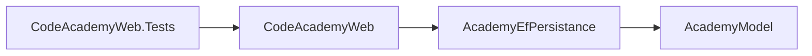

# Architettura

## Progetti

| Progetto | Cartella | Contenuto |
|----------|----------|-----------|
| `AcademyModel` | `AcademyModel/` | Entità, interfacce di repository (`Repositories/I*Repository`) e servizi (`Services/I*Service`), eccezioni, estensioni NodaTime |
| `AcademyEfPersistance` | `AcademyPersistance/` | `AcademyContext` (EF Core + Npgsql + NodaTime), migration, repository EF (`Repository/EF*Repository`), servizi (`Services/EF*Service`) |
| `CodeAcademyWeb` | `CodeAcademyWeb/` | Host ASP.NET Core: `Startup.cs`, controller, DTO, Profile AutoMapper |
| `CodeAcademyWeb.Tests` | `CodeAcademyWeb.Tests/` | Unit test dei controller e test HTTP in-memory |

Dipendenze tra progetti:

## Dependency injection

`CodeAcademyWeb/Startup.cs` (`ConfigureServices`) registra:
- `AcademyContext` con la connection string `AcademyDb` (Npgsql + NodaTime, log dei comandi SQL su console).
- Servizi e repository come `Scoped`: `IAreasService` → `EFAreasService`, `ICoursesService` → `EFCoursesService`, `IEditionsService` → `EFEditionsService`, `IEnrollmentsService` → `EFEnrollmentsService`, `ILessonsService` → `EFLessonsService`, `IPeopleService` → `EFPeopleService`; un `EF*Repository` per ogni `I*Repository`.
- AutoMapper con `AddAutoMapper(cfg => { }, AppDomain.CurrentDomain.GetAssemblies())`: carica tutti i `Profile` degli assembly caricati.
- CORS aperto (`AllowAnyOrigin`) e OpenAPI.

## Flusso di una richiesta

I controller non contengono logica di business: convertono con AutoMapper, chiamano il servizio e scelgono lo status. Le date (`LocalDate` NodaTime) diventano stringhe `yyyy-MM-dd` nei DTO tramite `AcademyModel/Extensions/LocalDateExtensions.cs` o `ToString("yyyy-MM-dd")` nei Profile.

## Gestione errori

- I servizi segnalano un'entità inesistente con `EntityNotFoundException` (`AcademyModel/Exceptions/EntityNotFoundException.cs`), che espone `EntityName`.
- I controller che la gestiscono rispondono con `ErrorObject` (`StatusCode`, `Message`): 400 se manca un'entità collegata (corso, docente, studente, edizione), 404 se manca l'entità principale.
- Non c'è un middleware globale: le eccezioni non gestite (es. `ArgumentNullException` dei DELETE per id inesistente) diventano 500.
- `[ApiController]` restituisce 400 `ProblemDetails` se il body non è valido.

Le eccezioni gestite da ogni endpoint sono nei file in [modules/](README.md#indice).

## Livelli di test

| Livello | Cosa è reale | Cosa è mock |
|---------|--------------|-------------|
| Unit (`Controllers/`) | Controller, `IMapper` (Profile reali) | Servizi |
| HTTP (`Http/`) | Pipeline ASP.NET Core completa (routing, binding, `[ApiController]`, serializzazione JSON), `IMapper` | Servizi, registrati in DI da `ApiFactory` |

Servizi e repository EF sono esclusi: provider in-memory o SQLite non replicano Postgres e NodaTime. Vedi [decisions.md](decisions.md).
