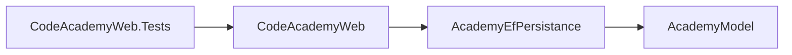
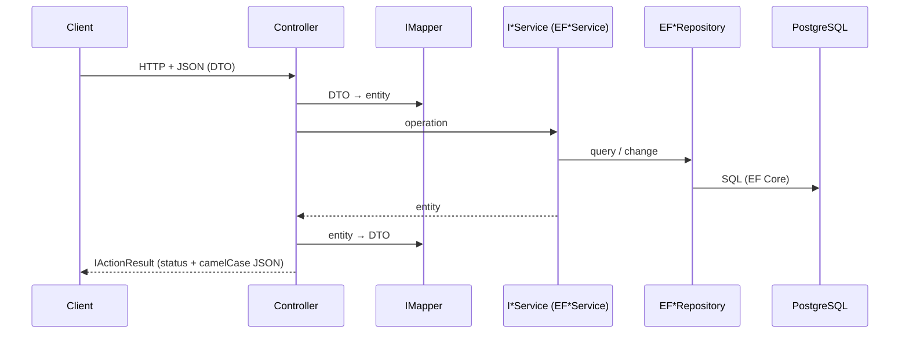

# Architecture

## Projects

| Project | Folder | Content |
|---------|--------|---------|
| `AcademyModel` | `AcademyModel/` | Entities, repository (`Repositories/I*Repository`) and service (`Services/I*Service`) interfaces, exceptions, NodaTime extensions |
| `AcademyEfPersistance` | `AcademyPersistance/` | `AcademyContext` (EF Core + Npgsql + NodaTime), migrations, EF repositories (`Repository/EF*Repository`), services (`Services/EF*Service`) |
| `CodeAcademyWeb` | `CodeAcademyWeb/` | ASP.NET Core host: `Startup.cs`, controllers, DTOs, AutoMapper Profiles |
| `CodeAcademyWeb.Tests` | `CodeAcademyWeb.Tests/` | Controller unit tests and in-memory HTTP tests |

Project dependencies:

## Dependency injection

`CodeAcademyWeb/Startup.cs` (`ConfigureServices`) registers:
- `AcademyContext` with the `AcademyDb` connection string (Npgsql + NodaTime, SQL commands logged to the console).
- Services and repositories as `Scoped`: `IAreasService` → `EFAreasService`, `ICoursesService` → `EFCoursesService`, `IEditionsService` → `EFEditionsService`, `IEnrollmentsService` → `EFEnrollmentsService`, `ILessonsService` → `EFLessonsService`, `IPeopleService` → `EFPeopleService`; one `EF*Repository` for each `I*Repository`.
- AutoMapper with `AddAutoMapper(cfg => { }, AppDomain.CurrentDomain.GetAssemblies())`: loads every `Profile` in the loaded assemblies.
- Open CORS (`AllowAnyOrigin`) and OpenAPI.

## Request flow

Controllers contain no business logic: they map with AutoMapper, call the service and pick the status. Dates (NodaTime `LocalDate`) become `yyyy-MM-dd` strings in the DTOs through `AcademyModel/Extensions/LocalDateExtensions.cs` or `ToString("yyyy-MM-dd")` in the Profiles.

## Error handling

- Services report a missing entity with `EntityNotFoundException` (`AcademyModel/Exceptions/EntityNotFoundException.cs`), which exposes `EntityName`.
- Controllers that handle it respond with an `ErrorObject` (`StatusCode`, `Message`): 400 when a related entity is missing (course, instructor, student, edition), 404 when the main entity is missing.
- There is no global middleware: unhandled exceptions (e.g. the `ArgumentNullException` of DELETE by non-existent id) become 500.
- `[ApiController]` returns 400 `ProblemDetails` when the body is invalid.

The exceptions handled by each endpoint are listed in the files in [modules/](README.md#index).

## Test levels

| Level | Real | Mocked |
|-------|------|--------|
| Unit (`Controllers/`) | Controller, `IMapper` (real Profiles) | Services |
| HTTP (`Http/`) | Full ASP.NET Core pipeline (routing, binding, `[ApiController]`, JSON serialization), `IMapper` | Services, registered in DI by `ApiFactory` |

EF services and repositories are excluded: in-memory or SQLite providers do not replicate Postgres and NodaTime. See [decisions.md](decisions.md).
